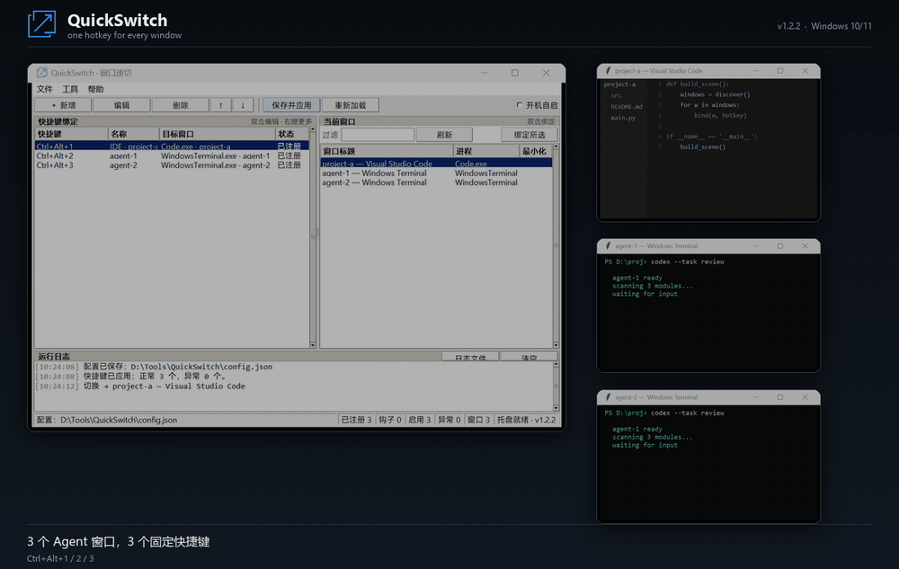
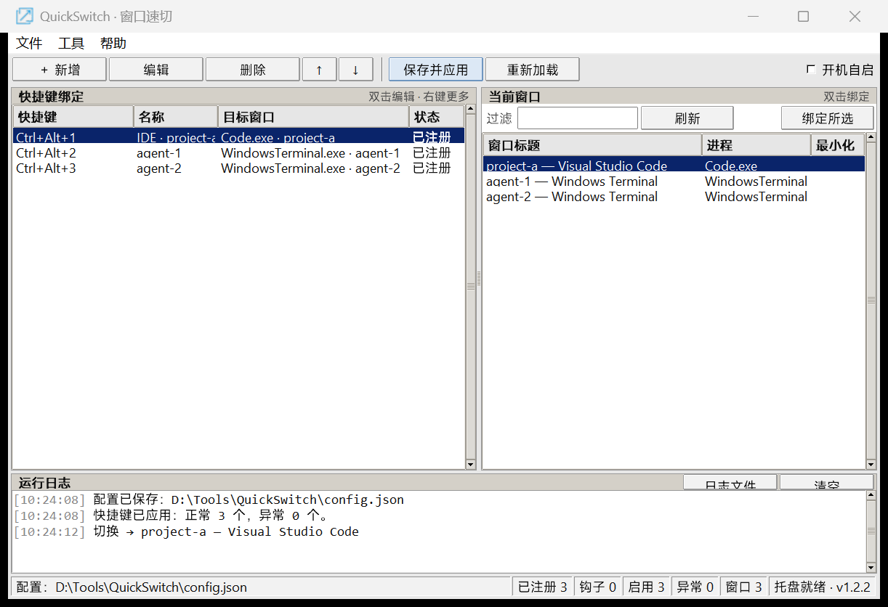
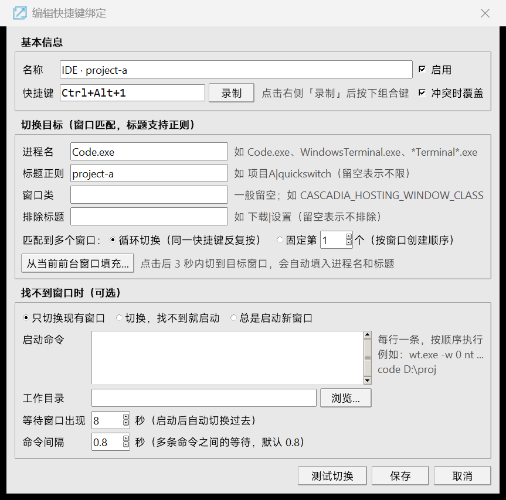

<p align="center">
  
</p>

<h1 align="center">QuickSwitch</h1>

<p align="center">
  <b>One hotkey for every window.</b><br>
  Jump straight to your IDE, terminal, or AI-agent window — no taskbar hunting, no <code>Alt+Tab</code> cycling.
</p>

<p align="center">
  <a href="https://github.com/hyl320/quickswitch/releases/latest"></a>
  <a href="https://github.com/hyl320/quickswitch/releases"></a>
  
  
</p>

<p align="center">
  <a href="https://github.com/hyl320/quickswitch/releases/latest"><b>Download for Windows</b></a>
  &nbsp;·&nbsp;
  <a href="#quick-start">Quick start</a>
  &nbsp;·&nbsp;
  <a href="#configuration">Configuration</a>
  &nbsp;·&nbsp;
  <a href="#中文说明">简体中文</a>
</p>

<p align="center">
  
</p>

<p align="center"><sub>Each window gets its own fixed shortcut. Press once — you are there.</sub></p>

## Why QuickSwitch

Switching windows should be muscle memory. QuickSwitch gives every project window, terminal, and AI-agent window its own global hotkey, so you stop hunting through the taskbar or cycling blindly through `Alt+Tab`.

It is built around a few ideas:

- **One key per window, not per app** — match by process, title, or window class to pin the exact instance; use round-robin or a fixed index when an app has many windows.
- **Shortcut conflicts are handled** — if a combo is already taken by Windows or another program, QuickSwitch can take it over with a low-level keyboard hook instead of asking you to pick another key.
- **One key can build a workspace** — launch your IDE, terminals, and browser in order, wait for the main window, then focus it; press again later and it simply switches back.
- **No scripting, no installer** — a single portable exe with a tray icon, autostart option, JSON config, and a hotkey recorder.
- **Local only** — no telemetry, no network calls, no browser engine.

## Features

| | Feature |
| --- | --- |
| **Fixed shortcuts** | Bind any window to any global combo, e.g. `Ctrl+Alt+1` for your IDE, `Ctrl+Alt+2/3` for agent terminals. |
| **Instance matching** | Match by process name (globs allowed), title regex, window class, and exclude-title rules. |
| **Round-robin or fixed** | One hotkey cycles through several terminal windows, or always jumps to the same nth window. |
| **Shortcut takeover** | Conflicts are detected; with override enabled QuickSwitch installs a `WH_KEYBOARD_LL` hook and wins. |
| **Workspace launch** | Run several commands in order (one per line), wait for the main window, then focus it. |
| **Quiet UX** | Tray icon, optional autostart, and a lightweight in-app toast instead of system notifications. |
| **Config that stays yours** | Plain JSON next to the executable; hot reload with `Ctrl+R`; no cloud sync. |
| **Portable** | Single exe, no Python needed, no admin rights; put it in any writable folder. |

## Download

**Portable exe — no Python required.** Grab `QuickSwitch.exe` from the [latest release](https://github.com/hyl320/quickswitch/releases/latest).

1. Put the exe in a writable folder, e.g. `D:\Tools\QuickSwitch`. The app creates `config.json` and `logs\` next to it.
2. Double-click it — no installer and no admin rights. The window opens and an icon appears in the notification area.
3. Optional: **工具 (Tools) → 创建桌面快捷方式 (Create desktop shortcut)**, then pin that shortcut to the taskbar.
4. Optional: enable **开机自启 (Start with Windows)** from the toolbar.

> The exe is not code-signed, so Windows SmartScreen may show *"Windows protected your PC"*: click **More info → Run anyway**. The SHA-256 is published in each release note.

### Run from source

```
git clone https://github.com/hyl320/quickswitch.git
cd quickswitch
python -m pip install -r requirements.txt
```

Source mode needs Windows 10/11 + Python 3.10+ with pywin32. Then double-click **`QuickSwitch.vbs`** (silent), or `setup-and-run.cmd` (installs dependencies and starts), or `run-console.cmd` to see errors.

## Quick start

1. Launch QuickSwitch (portable exe or `QuickSwitch.vbs` from source).
2. Click **刷新 (Refresh)** on the right, select the target window, then click **绑定所选 (Bind selected window)**.
3. In the editor, click **录制 (Record)**, press the combo you want, and save. The hotkey is active immediately.
4. Closing the window minimizes it to the tray; double-click the tray icon to bring it back.

> Prefer `Ctrl+Alt+number` combos. A global `Ctrl+1` will also swallow the browser/IDE shortcut of the same name — QuickSwitch *can* override it, but you may not want to.

## Screenshots

<p align="center">
  
</p>
<p align="center">
  
</p>

## How shortcut overriding works

1. QuickSwitch first registers each combo with `RegisterHotKey`. On success the system delivers the key to QuickSwitch and no other app sees it.
2. If the combo is already registered by Windows or another program (`ERROR_HOTKEY_ALREADY_REGISTERED`, 1409) and the binding has "override on conflict" enabled, QuickSwitch installs a `WH_KEYBOARD_LL` hook, swallows the key before hotkey processing, and performs the switch. The status column shows **钩子接管 (hook)**.
3. Keys that **cannot** be overridden: `Ctrl+Alt+Del`, `Win+L`, and anything handled by the secure attention sequence. Fullscreen exclusive games may also ignore hooked input.
4. If the target app runs elevated, run QuickSwitch elevated too; otherwise UIPI may block input to that window.

## Workspace launch

A binding can launch several commands in order and then jump to its main window. With `activateOrLaunch`, the first press builds the scene, and later presses just switch back to it — nothing is relaunched while the window exists.

```jsonc
{
  "name": "Project A",
  "hotkey": "Ctrl+Alt+3",
  "process": "Code.exe",
  "title": "project-a",
  "when": "activateOrLaunch",
  "launch": "wt.exe -w 0 nt pwsh -NoExit -Command \"cd D:\\proj\"\ncode D:\\proj\nstart https://github.com",
  "launch_gap": 1.0,
  "wait_seconds": 20
}
```

- one command per line, executed top to bottom (shell syntax; `start <url>` opens the default browser);
- `launch_gap` — seconds between commands, so terminals/windows have time to open;
- `wait_seconds` — how long to wait for the matching window before focusing it;
- close the scene's main window and press the hotkey again to rebuild it.

## Configuration

The config lives next to the app in `config.json` (edit it from **文件 (File) → 打开配置文件 (Open config file)** and press `Ctrl+R` to reload). See [config.example.json](config.example.json).

```jsonc
{
  "version": 1,
  "start_with_windows": false,   // write HKCU Run entry
  "start_minimized": false,      // start hidden in the tray
  "close_to_tray": true,
  "notifications": true,         // in-app toast when hiding to tray
  "bindings": [
    {
      "id": "terminal-1",
      "name": "Terminal 1",
      "hotkey": "Ctrl+Alt+1",
      "enabled": true,
      "process": "WindowsTerminal.exe", // glob patterns allowed: *Terminal*.exe
      "title": "",                      // case-insensitive regular expression
      "window_class": "",
      "exclude_title": "",
      "index": 1,          // 0 = cycle through matches; N = fixed Nth window (creation order)
      "override": true,    // take over conflicting hotkeys via the keyboard hook
      "when": "activate",  // activate | activateOrLaunch | launch
      "launch": "",        // one command per line
      "launch_cwd": "",
      "launch_gap": 0.8,   // seconds between launch commands
      "wait_seconds": 8    // seconds to wait for the window after launching
    }
  ]
}
```

| `when` | Behavior |
| --- | --- |
| `activate` | Switch to an existing window only; log a warning when none matches |
| `activateOrLaunch` | Switch if found, otherwise run the `launch` commands and wait for the window |
| `launch` | Always start a new instance |

> Bindings created with "Bind selected windows" use `process + index`; if you reopen windows often, a stable `title` keyword (e.g. project name) is more reliable than an index.

## CLI

```
QuickSwitch.exe --selftest      # portable exe: hotkeys, window activation, launch, tray
QuickSwitch.exe --hidden        # start minimized to tray
python QuickSwitch.pyw --selftest   # source mode
```

## Limitations

- Windows 10/11 x64 only.
- Tab-level switching (terminal tabs, browser tabs) is not supported — QuickSwitch activates windows.
- Secure attention keys (`Ctrl+Alt+Del`, `Win+L`) cannot be captured; fullscreen exclusive games may ignore hooks.
- Elevation boundaries apply (UIPI).
- The portable exe is unsigned; SmartScreen may warn.
- Workspace launch focuses the scene's main window; it does not restore window positions or multi-monitor layouts.

## Development

```
python -m pytest tests -q            # 34 unit tests
python -m quickswitch --selftest     # 25 self-check items
python tests/gui_capture_qa.py       # GUI acceptance: dialogs, recorder, save
python tests/e2e_hotkey_qa.py        # end-to-end: real keys → hotkey/hook → window switch
.\build-release.ps1 -Version 1.2.2   # build dist/QuickSwitch.exe + SHA-256
```

Project layout:

```
QuickSwitch.pyw          entry point (run with pythonw)
QuickSwitch.vbs          silent launcher (double-click)
run-console.cmd          launcher with console output
setup-and-run.cmd        source mode: pip install + launch
build-release.ps1        portable exe build (PyInstaller)
requirements-build.txt   build-time dependencies
quickswitch/
  app.py                 Tkinter UI, event loop, switching/launching
  hotkeys.py             message pump, RegisterHotKey, LL-hook override, tray
  winapi.py              window enumeration, foreground activation, hook, startup, single instance
  matcher.py             window matching and cycle/fixed-index selection
  config.py              config model, load/save, validation
  keys.py                hotkey string <-> virtual-key codes
  selftest.py            --selftest implementation
assets/                  icons, README screenshots and demo GIF
tests/                   unit tests, GUI/E2E QA scripts, fixtures
```

## License

[MIT](LICENSE) © 2026 侯义林

---

## 中文说明

[English](https://github.com/hyl320/quickswitch#readme) · **简体中文**

<p align="center">
  
</p>

**一个窗口，一个固定快捷键。** 按一下直接跳到 IDE、终端或 AI Agent 窗口，不用在任务栏里找，也不用反复 `Alt+Tab`。

### 为什么是 QuickSwitch

- **一个窗口一个键，而不是一个应用一个键**：按进程、标题、窗口类精确匹配到某个窗口实例；同一个应用开多个窗口时，用循环切换或固定序号区分。
- **能抢回被占用的快捷键**：组合键被系统或其它软件占用时，用低级键盘钩子接管，而不是让你换一个不顺手的位置。
- **一个键拉起整套环境**：IDE、终端、浏览器按顺序启动，等主窗口出现后自动切过去；之后再按只切回场景，不会重复启动。
- **不用写脚本，也不用安装**：单文件绿色版，托盘运行，支持开机自启、配置文件热加载和快捷键录制；不依赖 Python、不需要管理员权限、不联网。
- **为开发者和多 Agent 工作流设计**：面对一堆长得差不多的窗口，固定键位最符合肌肉记忆。

### 界面

<p align="center">
  
</p>
<p align="center">
  
</p>

### 下载与安装

**推荐方式：免安装绿色版（不需要 Python）**

1. 打开 [最新 Release](https://github.com/hyl320/quickswitch/releases/latest)，下载 `QuickSwitch.exe`。
2. 放到一个**可写目录**，例如 `D:\Tools\QuickSwitch`；程序会在 exe 同目录创建 `config.json` 和 `logs\`。
3. 双击运行即可，无需安装、无需管理员权限。窗口打开，托盘出现图标。
4. 想让任务栏图标更规整：菜单「工具 → 创建桌面快捷方式」，再用生成的 `.lnk` 固定到任务栏。
5. 需要开机自启就在界面右上角勾选「开机自启」。

> 该 exe 未做代码签名，Windows SmartScreen 可能提示"已保护你的电脑"：点「更多信息 → 仍要运行」，或用 Release 说明里的 SHA-256 校验完整性。

**从源码运行（需要 Python 3.10+）**

```
git clone https://github.com/hyl320/quickswitch.git
cd quickswitch
python -m pip install -r requirements.txt
```

然后双击 `QuickSwitch.vbs`（静默启动）或 `setup-and-run.cmd`（自动装依赖并启动）；要看报错就用 `run-console.cmd`。

### 快速开始

1. 启动程序（绿色版双击 `QuickSwitch.exe`；源码版双击 `QuickSwitch.vbs`）。
2. 点右侧「刷新」→ 选中目标窗口 → 点「绑定所选».
3. 在编辑框里点「录制」，按下想用的组合键，保存。**立即生效**。
4. 关闭窗口默认最小化到托盘，双击托盘图标可以再打开；托盘右键菜单里可以退出。

> 快捷键建议优先选 `Ctrl+Alt+数字`：`Ctrl+数字` 全局生效后会抢掉浏览器切换标签页、IDE 里同类快捷键。

### 热键冲突与"覆盖"的原理

1. 先用 `RegisterHotKey` 注册组合键。成功时最稳：系统会把按键直接发给 QuickSwitch，不会再传给当前程序。
2. 如果组合键已被别的程序注册（Windows 返回 1409），且该绑定勾选了"冲突时覆盖"，QuickSwitch 会安装 `WH_KEYBOARD_LL` 低级键盘钩子，在按键进入系统之前吞掉它，再执行切换。
3. **无法覆盖**：`Ctrl+Alt+Del`、`Win+L` 等由系统安全机制直接处理的按键；全屏独占游戏也可能收不到。
4. 如果目标程序以管理员身份运行，请也让 QuickSwitch 以管理员身份运行，否则发给高权限窗口的按键可能拦不住。

### 场景启动

一条绑定可以按顺序执行多条命令，然后切到它的主窗口。配合 `activateOrLaunch`：第一次按拉起 IDE + 终端 + 浏览器，之后按只切回主窗口，不会重复启动。

```jsonc
{
  "name": "项目 A",
  "hotkey": "Ctrl+Alt+3",
  "process": "Code.exe",
  "title": "project-a",
  "when": "activateOrLaunch",
  "launch": "wt.exe -w 0 nt pwsh -NoExit -Command \"cd D:\\proj\"\ncode D:\\proj\nstart https://github.com",
  "launch_gap": 1.0,
  "wait_seconds": 20
}
```

- 每行一条命令，从上到下执行（shell 语法；`start <网址>` 会用默认浏览器打开）；
- `launch_gap`：命令之间的等待秒数，避免终端/窗口还没起来；
- `wait_seconds`：启动后等待目标窗口出现的最长时间；
- 关掉场景主窗口后再按快捷键，就会重新拉起整套环境。

### 配置说明

配置保存在程序目录的 `config.json`（可以在界面「文件 → 打开配置文件」直接编辑，保存后 `Ctrl+R` 重载）。参考 [config.example.json](config.example.json)。

```jsonc
{
  "version": 1,
  "start_with_windows": false,   // 是否开机自启（界面里的勾选框会同步写注册表）
  "start_minimized": false,      // 启动时是否直接收进托盘
  "close_to_tray": true,         // 点关闭时是否最小化到托盘
  "notifications": true,         // 收进托盘时的应用内轻提示
  "bindings": [
    {
      "id": "terminal-1",        // 唯一 ID
      "name": "终端 1",           // 显示名
      "hotkey": "Ctrl+Alt+1",    // 组合键
      "enabled": true,
      "process": "WindowsTerminal.exe", // 进程名，支持 * 通配，如 *Terminal*.exe
      "title": "",               // 标题正则（不区分大小写，包含匹配）
      "window_class": "",        // 窗口类名子串，一般留空
      "exclude_title": "",       // 排除的标题正则
      "index": 1,                // 0 = 循环切换；N = 固定切到第 N 个（按窗口创建顺序）
      "override": true,          // 冲突时用键盘钩子覆盖
      "when": "activate",        // activate | activateOrLaunch | launch
      "launch": "",              // 启动命令（每行一条）
      "launch_cwd": "",          // 工作目录
      "launch_gap": 0.8,         // 多条命令之间的间隔秒数
      "wait_seconds": 8          // 启动后等待窗口出现的秒数
    }
  ]
}
```

`when` 三种模式：

| 值 | 行为 |
| --- | --- |
| `activate` | 只切换现有窗口，找不到就只写日志 |
| `activateOrLaunch` | 先切换；找不到再执行 `launch`，等窗口出现后切过去 |
| `launch` | 每次按快捷键都启动一个新实例 |

用"批量绑定"生成的绑定是 `process + index` 形式；如果你经常关掉/重开某些窗口，序号可能变化，这时把 `title` 填成窗口标题里的稳定关键字（如项目名）会更可靠。

### 开机自启

界面右上角勾选「开机自启」，会写入 `HKCU\Software\Microsoft\Windows\CurrentVersion\Run`，命令形如：

```
C:\Tools\QuickSwitch\QuickSwitch.exe --hidden          # 绿色版
"C:\Python312\pythonw.exe" "C:\QuickSwitch\QuickSwitch.pyw" --hidden   # 源码版
```

关闭勾选即移除，不改动系统其它设置。

### 常见问题

**快捷键按了没反应？**
先看左侧状态列和运行日志：
- `冲突` → 被占用，换组合键或勾选"冲突时覆盖"；
- 目标程序是管理员权限 → QuickSwitch 也以管理员身份运行；
- 目标是全屏独占游戏 → 系统限制，无法拦截。

**任务栏图标是空白页？**
如果你固定的是 `QuickSwitch.vbs` / `QuickSwitch.pyw` 文件，显示的是文件类型图标。请用新版 exe，或菜单「工具 → 创建桌面快捷方式」生成带图标的快捷方式后再固定。

**窗口序号怎么变了？**
`index` 是按窗口创建顺序（句柄）排的，重开窗口会变化。改用标题正则，或者用 `index: 0`（循环切换）。

**托盘图标找不到？**
Windows 默认会折叠托盘图标，点任务栏右下角 `^` 展开，或把图标拖到常驻区域。

**启动失败怎么排查？**
用 `run-console.cmd` 启动，或看 `logs/quickswitch.log`、界面底部日志。

### 已知限制

- 仅支持 Windows 10/11 x64。
- 无法覆盖 `Ctrl+Alt+Del`、`Win+L` 等安全按键；全屏独占游戏可能拦截失败。
- 管理员权限窗口与普通权限 QuickSwitch 之间存在 UIPI 限制。
- 窗口匹配基于标题/进程/类名，Electron 应用标题会随文件变化，建议用项目名做标题正则。
- 只支持窗口级切换，暂不支持终端/浏览器内部的标签页切换。
- 场景启动只负责拉起命令并切回主窗口，不会恢复窗口位置/多屏布局。

### 开发与验证

```
python -m pytest tests -q            # 纯逻辑单元测试（34 项）
python -m quickswitch --selftest     # 自检：窗口枚举/热键/钩子/前台切换/启动命令（25 项）
python tests/gui_capture_qa.py       # 手工 GUI 验收：打开编辑框、录制快捷键、保存、截图
python tests/e2e_hotkey_qa.py        # 端到端：真实按键 → 系统热键/钩子 → 切到记事本
```

打包发布版 exe：

```
python -m pip install -r requirements-build.txt
.\build-release.ps1 -Version 1.2.2
```

输出 `dist\QuickSwitch.exe` 和 `dist\QuickSwitch.exe.sha256`；把 exe 上传到 GitHub Release 即可。绿色版把配置和日志放在 exe 同目录。

### 许可证

[MIT](LICENSE) © 2026 侯义林

---

如果 QuickSwitch 帮你省了时间，点个 ⭐ 能让更多人发现它。

If it saves you time, a star helps other people find it.
